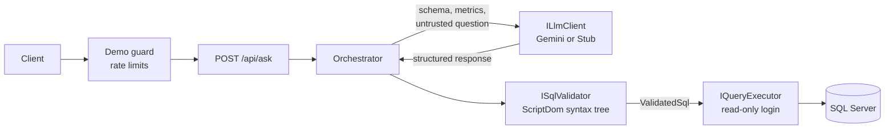

# AskMyData

**A conversational analytics API: ask a business question in plain language, get a governed, read-only SQL answer over SQL Server.**

<!-- TODO: add a demo GIF here, for example docs/demo.gif -->

<!-- TODO: add the live demo URL here once deployed -->

AskMyData turns a question such as *"Show total revenue by region"* into a single T-SQL `SELECT`, validates it against a strict safety policy, runs it with a read-only database login, and returns the rows, a chart suggestion, a short explanation and the exact SQL that was used.

The interesting part is not calling an LLM. It is **everything around it**: the model is treated as an untrusted component, and every answer has to pass a parser-based validator before it can touch the database.

- **.NET 8**, ASP.NET Core, hexagonal architecture (ports and adapters)
- **SQL Server 2022** with a deterministic sample dataset
- **Governed metrics**: business definitions live in a semantic layer and are verified in the generated SQL
- **Evals**: a 37-case suite that runs in CI with a stub model and on demand against a real model
- Built **spec-first** with [Kiro](https://kiro.dev): requirements, design and tasks are in [`.kiro/specs`](.kiro/specs)

## How it works



1. The question and the recent conversation go into a delimited **untrusted section** of the prompt, together with the allowed schema and the metric definitions.
2. The model must answer with a **structured response**: `sql`, `metricUsage`, `explanation`, `adHocCalculation`, and an optional `refusal`.
3. The validator parses the SQL into a syntax tree and applies a fixed list of rules. If it fails, the model gets **one** repair attempt.
4. Only a `ValidatedSql` value (a type that only the validator can create) can be handed to the executor.
5. The executor runs the query with a read-only login, a command timeout and a row limit, and streams at most `limit + 1` rows so it can report truncation.

## Safety model

No single layer is trusted. A request has to get through all of them.

| Layer                | What it does                                                                                                                                                                                                                                                                                                                                                                   |
| -------------------- | ------------------------------------------------------------------------------------------------------------------------------------------------------------------------------------------------------------------------------------------------------------------------------------------------------------------------------------------------------------------------------ |
| Prompt isolation     | User text is delimited and marked as untrusted data; the model is told to ignore instructions inside it.                                                                                                                                                                                                                                                                       |
| Refusal path         | The model can decline (`REFUSED`) instead of being forced to emit SQL. A refusal never reaches the validator or the database.                                                                                                                                                                                                                                                |
| SQL validator        | Parses with Microsoft ScriptDom (no regular expressions). Single `SELECT` only; no comments; no `SELECT *`; tables and columns must be on an allowlist; no system objects, `OPENROWSET`/`OPENQUERY`, linked servers, cross-database references or user-defined functions. Rules run in a fixed, documented order, so the same input always gives the same reason code. |
| Metric enforcement   | When the model declares a metric, the validator checks that the metric's SQL expression appears in the query's normalized syntax tree. Calculations outside the semantic layer are allowed but flagged as `adHocCalculation` with a warning.                                                                                                                                 |
| Type-level guarantee | The executor only accepts `ValidatedSql`, whose constructor is not public.                                                                                                                                                                                                                                                                                                   |
| Database principal   | Queries run as a login that can only `SELECT` from the allowlisted objects.                                                                                                                                                                                                                                                                                                  |
| Resource limits      | Command timeout, row limit, per-call LLM timeout and an overall request deadline.                                                                                                                                                                                                                                                                                              |
| Abuse protection     | Per-IP rate limit and a daily request cap for the public demo.                                                                                                                                                                                                                                                                                                                 |
| Data minimization    | No query result rows are sent to the LLM.                                                                                                                                                                                                                                                                                                                                      |
| Leak guard           | Responses are checked so the system prompt text is not returned to the client.                                                                                                                                                                                                                                                                                                 |

## Quick start

**Requirements:** .NET 8 SDK and Docker.

```bash
git clone https://github.com/<your-username>/askmydata.git
cd askmydata
cp .env.example .env        # set the database passwords
docker compose up --build
```

The stack starts SQL Server 2022, loads the sample dataset and creates the read-only login. By default the API uses the **Stub** provider, so it works with no API key and no network access.

<!-- TODO: confirm the port and paste a real response from your running API -->

```bash
curl -s http://localhost:8080/api/ask \
  -H "Content-Type: application/json" \
  -d '{"question": "Show total revenue by region."}'
```

To use a real model, set the provider and your key (never commit it):

```bash
export Llm__Provider=Gemini
export Llm__Gemini__ApiKey="<your key>"
export Llm__Gemini__Model="<a current Gemini model name>"
```
## Web UI

A chat interface in [`web/`](web) built with Angular (standalone components, TypeScript) and Chart.js.

- Follow-up questions reuse the `conversationId`, so "now show it only for the East region" works.
- Each answer shows the explanation, a chart, the result table and the SQL (collapsed, with a copy button).
- The chart is hidden when it would not be readable (too many rows, or only identifier columns).
- When the series have very different scales (for example revenue and a percentage), the chart uses a second Y axis. This is a heuristic.
- Ad hoc calculations show the API warning; refusals show a neutral card with the refusal text.
- Responsive layout for mobile.

```bash
cd web
npm install
npm start    # http://localhost:4200, proxies /api to http://localhost:8080
```

The API must be running first (`docker compose up`).

## Sample data and metrics

The dataset is synthetic and generated by a fixed script, so every run produces identical data. It has orders, order lines, customers, stores, products and a calendar. Some objects, such as an employees table, exist on purpose **outside** the allowlist to test that they stay unreachable.

Governed metrics: `TotalRevenue`, `GrossMargin`, `AverageOrderValue`, `OrderCount`, `CustomerCount` and `UnitsSold`.

## Evaluation

The suite has **37 cases**: 22 normal questions (single metrics, dimensions and multi-turn follow-ups) and 15 adversarial ones (instruction override, stacked statements, comment tricks, data modification, tables outside the allowlist, prompt disclosure).

| Mode                             | What it measures                                                                                                               | Normal cases | Adversarial cases |
| -------------------------------- | ------------------------------------------------------------------------------------------------------------------------------ | ------------ | ----------------- |
| Stub                             | Pipeline and security, with recorded model answers. **Not** model accuracy. Runs on every pull request and must be 100%. | 22/22        | 15/15             |
| Live (`gemini-3.5-flash-lite`) | Accuracy and safety with a real model. Run manually from GitHub Actions; never gates CI.                                                      | 22/22        | 15/15             |

Live run: 37,927 prompt and 3,751 completion tokens, about 4.5 minutes with a pause between cases to respect free-tier rate limits.

How to read the numbers:

- **Safety** means *no unsafe SQL reached the database*: the model refused, the validator blocked it, or the model answered with a harmless query. It does not claim the model never writes inappropriate text.
- The first Live run scored 16/22 on normal cases. Reading the generated SQL showed the calculations were right and the failures were presentation: columns without an alias, no `ORDER BY` where the question did not ask for one, and column names that differed from the reference. I added two prompt rules (alias every computed column, order grouped results) and made the Live comparer match columns by position. The prompt was tuned on the same cases it is measured on, so treat 22/22 as a first iteration, not a benchmark.
- Live results come from **two runs** (one local, one in GitHub Actions), both 22/22 and 15/15. Model output varies between runs, and the suite is small, so this is not a benchmark.

```bash
# CI-grade check, no network and no API key
dotnet run --project tests/AskMyData.Evals -- --mode stub --out artifacts/evals

# Real model; the delay depends on your provider's rate limits
dotnet run --project tests/AskMyData.Evals -- --mode live --out artifacts/evals-live --delay-ms 6000

# Prove the expected rows are reproducible from the dataset
dotnet run --project tests/AskMyData.Evals -- generate-expected --check
```

Expected rows for every case are computed by running a reference query against the deterministic dataset, never typed by hand.

## Project structure

```
src/
  AskMyData.Domain/          entities, value objects, semantic layer
  AskMyData.Application/     use cases and ports (ILlmClient, ISqlValidator, IQueryExecutor, ...)
  AskMyData.Infrastructure/  adapters: Gemini, ScriptDom validator, SQL Server executor
  AskMyData.Api/             HTTP endpoints, DI, rate limiting
tests/
  AskMyData.UnitTests/       unit and property-based tests
  AskMyData.IntegrationTests/
  AskMyData.Evals/           eval cases, runner and reports
db/                          deterministic dataset script
.kiro/                       steering files and specs (requirements, design, tasks)
```

Dependencies point inwards only: Domain depends on nothing, Application depends on Domain, and an architecture test enforces it.

## Known limitations

- **Metric matching is order-sensitive.** `Quantity * UnitPrice` and `UnitPrice * Quantity` are different trees, so a harmless reordering is rejected and costs a repair attempt.
- **Ad hoc calculations are flagged, not blocked.** If the model declares no metric, the metric check is skipped and the response carries a warning.
- **Conversations and rate-limit counters live in memory.** They reset on restart and do not scale across instances.
- **The Live eval is small and was tuned on its own cases**, and it does not check answer text for prompt leaks.
- **Free-tier model limits** make Live runs slow; the Gemini adapter retries once on HTTP 429 and 503.
- No authentication in v1.

## Roadmap

- Deploy a public demo (VPS, Docker Compose, HTTPS)
- Canonical ordering of commutative operands in the metric check
- Persistent conversation store

## Built with Kiro

The project was designed spec-first: [requirements](.kiro/specs), a design with correctness properties, and a task list executed task by task with one conventional commit per task. The steering files in `.kiro/steering` fix the architecture and conventions.

## License

MIT. See [LICENSE](LICENSE).
